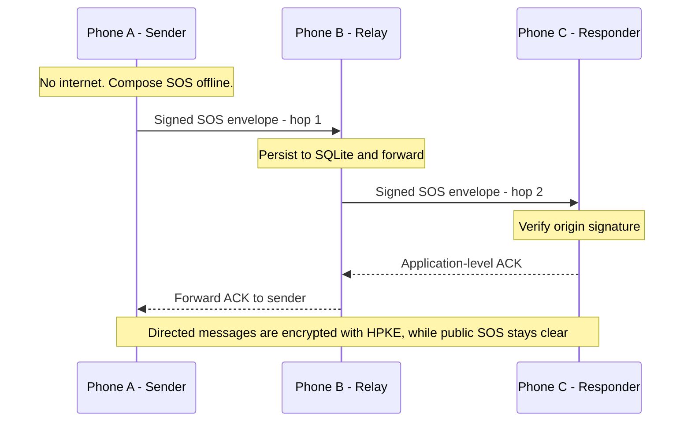
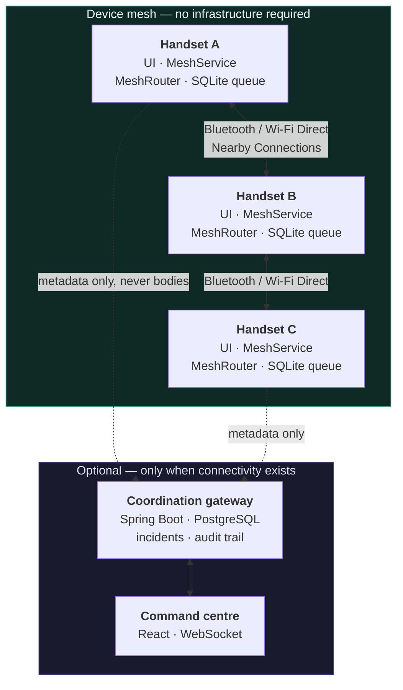

<div align="center">

# ResQNet

### When the Internet Goes Down, Communication Doesn't Have To.

**Created and maintained by [@Gautam-aman](https://github.com/Gautam-aman).**

Open-source contributions are welcome! 🤝

---

Offline-first emergency messaging over a peer-to-peer device mesh.

[](https://adoptium.net/)
[](https://developer.android.com/studio/releases/platforms)
[](docs/architecture/README.md)
[](https://github.com/Gautam-aman/ResQNet/actions/workflows/java.yml)
[](LICENSE)
[](https://github.com/Gautam-aman/ResQNet/releases)

</div>

---

## Start contributing

You don’t need mesh-networking expertise to make a useful first contribution.
Start with documentation, Java, Android, frontend, or reproducible testing.

**[Browse open Good First Issues](https://github.com/Gautam-aman/ResQNet/issues?q=is%3Aissue+is%3Aopen+label%3A%22good+first+issue%22)**
· [Contributor quickstart](CONTRIBUTING.md#contributor-quickstart)
· [Explore contributor opportunities](https://res-q-net-silk.vercel.app/contribute)

Check the issue’s current assignees, comment `/assign`, and wait for confirmation.
Then fork, build, run the relevant tests and open a focused PR. Ask for help in
the issue; use `/unassign` if you need to release it.

Real-device testing is especially valuable: start with the
[Android hardware guide](apps/android/DEVICE_TESTING.md), even with one phone.
Use dummy messages and report the build, device, steps, actual results and any
blocked checks. Simulation is not evidence of real multi-hop radio performance.

## Try the simulator in 60 seconds

Want to verify the mesh routing without setting up Android phones or a gateway?
You only need **JDK 21** and **Maven 3.9+**. In a fresh clone, open a terminal
at the repository root, check the versions, then run:

```sh
java -version
mvn -version
mvn -pl packages/mesh-simulator -am package
java -jar packages/mesh-simulator/target/mesh-simulator-0.2.0-beta-runnable.jar --topology ring --nodes 10 --messages 15 --seed 50 --rounds 30 --out report.json
```

The build should end with `BUILD SUCCESS`. The simulator prints a
`Nodes:` summary and `Wrote .../report.json` on success. The JSON report is
written to `report.json` in the repository root; it can be explored in the
[Mesh Replay Lab](docs/mesh-replay-lab/README.md). The delivery rate counts
**directed messages only**, because broadcasts cannot be acknowledged.

This uses the real routing engine with **simulated radio**, **not physical
handset or radio testing**. The first Maven run may need to download dependencies,
so the heading is not a guaranteed wall-clock time. For the full seven-stage
demonstration and failure scenarios, follow the [demo guide](docs/demo.md).

---

## 1. Introduction

ResQNet is a mesh networking layer for phones. It carries emergency messages
between nearby devices when the infrastructure they normally depend on is
gone — a cell tower without power, a flooded exchange, a cut fibre.

The radios are already in the phones. So are the batteries, and so are the
people who need to reach each other. ResQNet is the layer that makes those
radios useful to one another.

A handset composes an SOS. The message is handed to whichever devices are
connected, they hand it onward, and it keeps moving until it reaches the device
that owns the responder — or until its lifetime expires. **No server is involved
at any point on that path.** The coordination gateway is optional, runs only
when there is connectivity, and is never on the emergency path.

> **This is experimental research software.** It is not a substitute for
> official emergency services and must not be relied upon as one.

---

## 2. Animated preview and demo

<div align="center">
  
  <br>
  <sub><strong>Concept visualization — not actual device-test footage.</strong>
  This is an illustrative animation produced for the project. It is not a
  screen recording of the Android app and not a measurement of real radio
  behaviour.</sub>
</div>

**[Watch the full 38-second explainer (MP4, 1.2 MB)](docs/assets/media/ResQNet_Animated_Explainer.mp4)** —
also a concept visualization, with the same disclaimer applying.

[](docs/assets/media/ResQNet_Animated_Explainer.mp4)

A step-by-step demonstration script with exact commands and failure injection
is in [docs/demo.md](docs/demo.md).

The public web app also includes a **Mesh Replay Lab** at `/lab`. It imports a
report written by the Java simulator, replays the recorded events, inspects the
handoffs behind a message and compares two runs. Reports are read locally and
every view is labelled **SIMULATED — NOT REAL RADIO TELEMETRY**. The usage
guide, report schema notes and known limits are in
[docs/mesh-replay-lab/README.md](docs/mesh-replay-lab/README.md).

---

## 3. Why ResQNet exists

Disasters do not fail gently. The first thing to go is usually the thing
everything else depends on.

| What fails | What still works |
|---|---|
| Cell towers lose power | Bluetooth and Wi-Fi radios stay on |
| Backhaul is cut | Handsets are still in each other's range |
| The internet is unreachable | People are still holding the phones |
| An account system is unreachable | A key pair is already on the device |

Infrastructure-scale networks need infrastructure. A mesh does not. The
constraint is honest and small: if a message cannot reach a recipient within
the hop budget before its lifetime expires, it is reported as expired rather
than as delivered.

---

## 4. Key capabilities

- **Works with no infrastructure.** No server, account, or SIM is required on
  the emergency path.
- **Store and forward.** A relay persists a message before acknowledging it,
  and the queue survives the process dying.
- **Cryptographic identity.** Identity is a key, not an account. Every envelope
  is signed; there is no trust-on-first-use.
- **End-to-end encrypted directed messages.** SOS and text addressed to one
  verified peer are encrypted with HPKE (X25519 + HKDF-SHA256 + AES-256-GCM) and
  authenticated in a form relays can carry but not read. Public SOS broadcasts
  remain deliberately unencrypted.
- **Offline triage.** A keyword classifier runs on the handset with no network,
  so a category and severity exist before anything is transmitted.
- **Explicit delivery states.** `SENT_TO_PEER` and `ACKNOWLEDGED` are never
  collapsed into one another.
- **Honest failure.** A message that could not be delivered is reported as
  expired or failed, never as delivered.

---

## 5. How offline mesh networking works



Four rules govern forwarding:

1. **Split horizon.** An envelope is never handed back to the peer it arrived
   from, which removes the most common loop.
2. **Hop budget.** Every relay decrements a bounded budget. A flood wider than
   the budget cannot cross it, however long the sender waits.
3. **Duplicate suppression.** Keyed on message id and bounded on three axes —
   entries, bytes, and age — so a long-running handset cannot grow without
   limit.
4. **Signature verification.** Each hop verifies against a key the owner has
   confirmed. A device you have never met is `UNVERIFIED`, not trusted.

### The distinction the system rests on

`SENT_TO_PEER` and `ACKNOWLEDGED` are different states and are never collapsed.

A successful Nearby Connections payload transfer proves one radio hop succeeded.
It does not prove a person received anything. The UI renders `SENT_TO_PEER` as
**"Handed to a nearby device"**, never as delivered, because a responder
deciding whether to hold a position needs to know the difference.

---

## 6. Architecture



The gateway and command centre sit **outside** the mesh on purpose. A handset
may synchronise with the gateway when it has connectivity and a responder
console reads from it, but nothing on the emergency path depends on it
existing. Synchronisation sends delivery metadata — ids, states, timestamps,
attempt counts. **Message bodies are never sent to it.**

The full design, including the reasoning behind each trade-off, is in
[docs/architecture/README.md](docs/architecture/README.md).

---

## 7. Android application

`apps/android` — Java, Android SDK, Nearby Connections.

- **Nearby Connections** via the current `ConnectionsClient` API, strategy
  `P2P_CLUSTER`.
- **Foreground service** so the mesh survives the screen turning off.
- **SQLite-backed durable queue**, so a queued message survives the process
  dying.
- **Compiles mesh-core from source.** A mesh-core change that breaks Android is
  caught by `apps/android/app/build.gradle` rather than at release time.
- **User-controlled mesh participation.** Mesh enablement is an explicit choice,
  not a default.

Minimum supported version is **Android 8.0 (API 26)**. Debug builds carry a
`.debug` application-id suffix, so a debug and a release build install side by
side without replacing each other.

> **Background restrictions matter.** Doze mode, battery optimisation and
  manufacturer-specific task killers can suspend the foreground service. See
  [Known limitations](#15-known-limitations).

---

## 8. Web command centre

`apps/web` — React 18, TypeScript, Vite, Zustand.

- A landing page that makes one claim and supports it.
- A responder command centre: queue, incident detail, live counters, topology.
- A live event stream over **WebSocket**, with polling fallback.

The client distinguishes *the gateway is unreachable* from *there are no
incidents*. Conflating them would let a responder act on a dashboard that is
quietly reporting an empty queue because it could not reach the server.

Generated simulator runs are labelled as simulated at every layer — the
dashboard, the API, and a database column. There is no path by which generated
data is presented as field telemetry.

---

## 9. Technology stack

| Layer | Technology |
|---|---|
| Mesh core | Java 21, zero runtime dependencies, runs unchanged on Android |
| Simulator | Java 21, discrete-event, deterministic from a seed |
| Gateway | Java 21, Spring Boot 3.5, PostgreSQL, Flyway, JPA/Hibernate |
| Android | Java, Android SDK, Nearby Connections `P2P_CLUSTER`, SQLite, Robolectric |
| Web | React 18, TypeScript, Vite, Zustand, WebSocket with polling fallback |
| CI | GitHub Actions: Java, backend (H2 + PostgreSQL), Android, instrumented Android, web |

---

## 10. Installation and quick start

Requires **JDK 21**, **Maven 3.9+**, **Node.js 24 LTS** for the web app.

```bash
git clone https://github.com/Gautam-aman/ResQNet.git
cd ResQNet

# Java modules: mesh core, simulator, gateway
mvn -q package

# Web
cd apps/web && npm ci && npm run build
```

### Run the gateway

```bash
java -jar services/backend/target/backend-*.jar \
  --spring.profiles.active=dev
```

Requires `RESQNET_JWT_SECRET` (32+ characters) and, to let any device
synchronise, `RESQNET_GATEWAY_TOKEN`. Without them the application refuses to
start, which is deliberate.

The `dev` profile seeds two accounts with the password `resqnet-dev`:
`responder` and `admin`. They exist only under `dev`.

To use PostgreSQL rather than H2:

```bash
RESQNET_DB_URL=jdbc:postgresql://localhost:5432/resqnet \
RESQNET_DB_USER=resqnet RESQNET_DB_PASSWORD=resqnet \
java -jar services/backend/target/backend-*.jar \
  --spring.profiles.active=dev
```

The backend jar has no bundled H2 driver, because H2 is test scope. Pointing it
at H2 fails at startup by design; it targets PostgreSQL.

### Run the web app

```bash
cd apps/web && npm run dev      # http://localhost:5173
```

The command centre is at `/command`. The dev server proxies `/api` and `/ws`
to `localhost:8080`.

### Build and install the Android app

```bash
cd apps/android
./gradlew assembleDebug

adb install -r app/build/outputs/apk/debug/app-debug.apk
```

Release signing reads four properties from your own Gradle home and is
deliberately unset in the repository. With any of the four missing,
`./gradlew assembleRelease` produces an **unsigned** APK — it does not fall back
to the debug key, because a debug-signed APK is installable and looks exactly
like a release until somebody tries to ship it.

```properties
# ~/.gradle/gradle.properties — never the project file, never committed
RESQNET_KEYSTORE_FILE=/absolute/path/to/resqnet-release.jks
RESQNET_KEYSTORE_PASSWORD=...
RESQNET_KEY_ALIAS=resqnet
RESQNET_KEY_PASSWORD=...
```

---

## 11. Download the Android APK

The first publicly downloadable Android build ships with
**[v0.2.0-beta](https://github.com/Gautam-aman/ResQNet/releases)**, published as
a **pre-release**.

| | |
|---|---|
| Package | `dev.resqnet.android` |
| Minimum Android | 8.0 (API 26) |
| Signing | Release keystore, verified with `apksigner` |
| Checksums | `SHA256SUMS` alongside every release asset |

Installation is covered in
[docs/release/0.2.0-beta/INSTALLATION.md](docs/release/0.2.0-beta/INSTALLATION.md).
Verify the SHA-256 checksum before installing, and only install APKs obtained
from this repository's releases page.

> Installing APKs outside the Play Store should only ever be done from a source
> you trust. This build is experimental and is offered for evaluation.

---

## 12. Network simulator

`packages/mesh-simulator` is a discrete-event model of the **same routing
code**. It is not a mock: it runs the real `MeshRouter` with a modelled radio.

- Line, ring, star, mesh, two-cluster and random topologies.
- Link loss, churn and partition modelling.
- Reproducible from a seed. See [Reproducibility](#reproducibility).
- Publishes reports straight into a running gateway.

```bash
CP=packages/mesh-simulator/target/classes:packages/mesh-core/target/classes

java -cp $CP dev.resqnet.mesh.simulator.SimulatorCli \
  --topology mesh --nodes 12 --messages 40 --seed 7 --rounds 60 \
  --out /tmp/report.json
```

Useful flags: `--drop 0.2` to lose 20% of frames, `--churn 6` to cut and restore
a link every six rounds, `--partitioned` to start with the busiest relay offline.

### Publish a run into the gateway

```bash
RESQNET_GATEWAY_TOKEN=dev-device-token \
java -cp $CP dev.resqnet.mesh.simulator.SimulatorCli \
  --topology mesh --nodes 14 --messages 50 --seed 11 --quiet \
  --gateway http://localhost:8080/api/v1/simulations
```

Ingestion authenticates as a *device*, using the shared token. This is
deliberate: a simulator is a generator, not a handset, and giving it a human
session would imply an accountability model that does not exist.

### The demonstration

```bash
java -cp $CP dev.resqnet.mesh.simulator.demo.DemoScenario
```

Seven stages over the real `MeshRouter` with a modelled radio: composition with
no network, two-hop delivery, a relay vanishing mid-flight, recovery, gateway
sync without content, end-to-end confirmation, and the responder view. It exits
non-zero if any stage misbehaves, and three tests assert on that result.

The same demonstration runs from a release artifact with no infrastructure:

```bash
java -cp dist/resqnet-simulator-v*.jar \
  dev.resqnet.mesh.simulator.demo.DemoScenario
```

---

## 13. Benchmarks and test evidence

### Test suites

| Suite | Tests | Command |
|---|---:|---|
| mesh-core | 154 | `mvn -pl packages/mesh-core test` |
| simulator | 51 | `mvn -pl packages/mesh-simulator -am test` |
| backend (H2) | 60 | `mvn -pl services/backend test` |
| backend (PostgreSQL) | 7 | runs in CI against `postgres:16-alpine` |
| Android unit + Robolectric | 56 | `cd apps/android && ./gradlew testDebugUnitTest` |
| Android instrumented | 33 | `cd apps/android && ./gradlew connectedDebugAndroidTest` |
| Web | 46 | `cd apps/web && npm run test` |

Seven simulator tests are tagged `slow` because they run whole simulated meshes
rather than methods. They are excluded from an ordinary build so a push stays
quick, and CI asks for them explicitly with `-DexcludedTestGroups=`, so nothing
is silently skipped.

Instrumented tests run in CI at 320×640 @ 160 dpi, and have also been run
locally at 1080×2400 @ 420 dpi. Multi-emulator testing has not been performed.

The PostgreSQL integration tests are **not** run by default, because they need a
live server:

```bash
mvn -pl services/backend -am test \
  -Dspring.profiles.active=postgres \
  -Dtest=PostgresMigrationIT \
  -Dsurefire.failIfNoSpecifiedTests=false
```

with `TEST_PG_URL`, `TEST_PG_USER` and `TEST_PG_PASSWORD` pointing at a live
instance.

### Benchmarks

**Delivery figures are computed over directed messages only.** A broadcast has
no destination, so nothing can acknowledge it, and counting broadcasts in the
denominator capped the reported rate below 100% however well the mesh
performed. Both counts are reported separately.

**What limits delivery is the graph, not the router.** `TopologyDiagnostics`
measures the shapes the simulator builds. `MESH` is a circulant band of diameter
n/4, so at 500 nodes only a quarter of node pairs are inside a 32-hop budget.
Across hop budgets at 100 nodes the router reaches 98–100% of what the graph
permits, and at 500 nodes the measured 21.6% sits directly under the 25.7%
structural ceiling. The full argument, including seven causes that were tested
and ruled out, is in [docs/routing-analysis.md](docs/routing-analysis.md).

Mesh topology, one seed, same messages at every size:

| Nodes | 4 hops | 8 hops | 16 hops | 32 hops |
|---:|---:|---:|---:|---:|
| 10 | 90.0% | 90.0% | 90.0% | 90.0% |
| 50 | 15.0% | 50.0% | 90.0% | 90.0% |
| 100 | 24.0% | 44.0% | 76.0% | 88.0% |
| 500 | 2.4% | 4.0% | 10.4% | 21.6% |

The headline finding is that **hop budget, not mesh size, decides whether a
message crosses**. A flood travels one hop per relay, so a mesh wider than the
hop budget cannot be crossed no matter how long the sender waits.

Full numbers, with the host they were measured on, are in
[docs/benchmarks/results.md](docs/benchmarks/results.md).

**These are simulation results, not field measurements.**

### What has actually been tested

This distinction is the most valuable thing in the repository. It is easy to
erode, so it is stated explicitly:

| Evidence class | Status |
|---|---|
| Automated unit and JVM tests | ✅ Passing, run in CI |
| Robolectric tests | ✅ Passing |
| Emulator instrumentation | ✅ Passing, at two geometries |
| Simulator multi-hop demonstration | ✅ Passing, deterministic from a seed |
| Backend against real PostgreSQL | ✅ Passing in CI |
| **Physical devices** | ⚠️ **Developer-reported only** |
| **Three-phone multi-hop** | ❌ **Not verified** |

**Physical-device testing.** The developer reports the Android application
working on **two physical phones**. That is a user report, not independently
verified evidence, and it is not evidence of multi-hop routing: with two phones
in range of each other there is no third device to relay through, so
`P2P_CLUSTER` connects them directly and no hop is taken.

**Not verified:** end-to-end offline delivery between three or more physical
devices, cryptographic acknowledgements over real radios, physical radio range,
and battery behaviour under continuous mesh participation.

The procedure for running a proper hardware test is in
[apps/android/DEVICE_TESTING.md](apps/android/DEVICE_TESTING.md).

### Reproducibility

`SimulationReport.volatileJsonFields()` names exactly three things that cannot
be byte-stable across runs of the same seed, and everything else is
reproducible: the wall-clock and throughput measurements, and the freshly
generated device ids and key fingerprints.

Every routing decision, counter, latency and hop distribution is a function of
the seed. This is enforced by a test that forks the CLI in a separate JVM,
because the failure mode it guards against is invisible in-process: the JDK
randomises its immutable collection iteration order once per JVM, so two runs in
one process agree with each other and disagree with every other process.

```bash
python3 scripts/compare_reports.py /tmp/a.json /tmp/b.json
```

---

## 14. Security and privacy

Threat model in [docs/security/threat-model.md](docs/security/threat-model.md).
E2EE overhead measurements are in
[docs/benchmarks/e2ee.md](docs/benchmarks/e2ee.md).

- **No trust on first use.** Identity is a key. A device you have never met is
  `UNVERIFIED`, not trusted. Keys are exchanged explicitly, out of band, and the
  two people compare short fingerprints in person.
- **Signatures.** Envelopes are signed with ECDSA over P-256
  (`SHA256withECDSA`). A device's id is derived from its public key, so there is
  no account to lose and no server that can impersonate a handset.
- **Devices cannot act.** The gateway token authorises reporting only. It can
  never open, assign or close an incident.
- **People and devices use different credentials.** A device cannot obtain a
  responder session, and a responder token cannot push device data.
- **Directed message bodies are end-to-end encrypted.** SOS or text addressed
  to one verified peer uses HPKE with a recipient key bound to that peer's
  signing identity by an ECDSA proof. Relays carry `SOS_PROTECTED` /
  `TEXT_PROTECTED` ciphertext and route on the signed header without decrypting.
- **Public SOS is explicitly not encrypted.** A broadcast is visible to every
  device in range and every relay. The composer labels it public and offers the
  encrypted directed path separately; it never silently downgrades.
- **No encryption-key substitution.** An HPKE key is accepted only with a proof
  signed by the announced signing key. A changed key for an existing identity is
  refused; v1 has no automatic rotation.
- **Message bodies never leave the mesh.** Synchronisation sends delivery
  metadata only.
- **The audit trail does not overstate authority.** A gateway-synchronised
  incident is recorded as `DEVICE`, because no human triaged it.

Known limitations are listed in the threat model rather than left implicit. The
most important: the shared gateway token is a bearer secret, so it is revocable
by rotation but not attributable, and every device holding it shares one
identity.

> **Directed payloads are encrypted; public broadcasts are not.** Envelope
> signatures guarantee authenticity and integrity. A message addressed to one
> verified peer is also confidential from relays and eavesdroppers. A public SOS
> broadcast is visible to anyone in range. Envelope metadata (origin,
> destination, type, timestamps and size) remains visible on both paths.

---

## 15. Known limitations

Stated plainly so they are not discovered by a reviewer.

**Validation gaps**

- **Three-device multi-hop routing has never been verified on physical
  hardware.** Several defects found by auditing the app would each have
  prevented a three-phone demonstration on their own. They are fixed, but
  nothing yet proves the radio path works end to end.
- **Real-world range and battery life are unknown.** The benchmarks measure the
  routing engine against a modelled radio. Nothing here is a claim about how far
  a message travels through a collapsed building.
- **Multi-emulator testing has not been performed.**
- **PostgreSQL under concurrency is untested.** Migrations and lifecycle are
  verified; write contention and replication are not.

**Platform behaviour**

- **Multi-hop cannot be observed when phones are in range of each other.** This
  is not a defect, but it looks like one. `P2P_CLUSTER` is an M-to-N strategy:
  every device within radio range connects to every other, so with three phones
  side by side, A to C is *one* hop and no relay is involved. A demonstration
  has to put the phones out of range of each other for the relay to exist at all,
  which is why `DEVICE_TESTING.md` insists on a closed door and on confirming C
  does not appear in A's peer list before sending.
- **Android background restrictions may suspend the mesh.** Doze mode, battery
  optimisation and manufacturer task killers can stop the foreground service.
- **No `P2P_CLUSTER` authentication token is used.** Google's API makes it
  optional. Trust is enforced one layer up, by envelope signature verification
  against a confirmed key — a stronger property, but it also means an
  unauthenticated peer can occupy a connection slot.

**Protocol and product**

- **Public SOS has no payload confidentiality.** Directed messages are E2EE, but
  a broadcast is readable by anyone in range. See
  [Security and privacy](#14-security-and-privacy).
- **No HPKE key rotation.** A peer that reinstalls and generates a new encryption
  key is refused until its identity is re-established. There is no user-visible
  rotation protocol in v1.
- **Outgoing directed plaintext is stored locally.** Sent bodies are kept in
  app-private SQLite so the sender can read their history; this is not full
  local-storage encryption. Incoming ciphertext is decrypted in memory only.
- **The peer-identity rebinding path is not proven by a challenge-response.**
  Rebinding a known identity to a new radio endpoint relies on the claimant
  presenting a public key already on file. A public key is public, so a device
  that has met the victim can rebind the victim's identity to its own endpoint
  and black-hole or read traffic addressed to them. It cannot *forge* frames as
  the victim. Closing this properly requires a link-bound challenge-response,
  which is not implemented.
- **Assignment and manual incident creation have working endpoints but no UI.**

**Known-unfixed operational notes**

- The shared gateway token is a single bearer secret for all devices.

---

## 16. Roadmap

Ordered by what would most increase confidence, not by what would look best.

1. **Physical multi-hop validation.** Run `DEVICE_TESTING.md` with three or more
   devices and record the result. This is the single largest gap.
2. **Challenge-response identity binding.** Close the rebinding limitation
   described above with a link-bound nonce the claimant must sign.
3. **HPKE key rotation.** Add a user-visible, proof-bound rotation protocol so a
   reinstalled peer can be encrypted to without re-establishing identity from
   scratch.
4. **Local-storage hardening.** Encrypt or expire the sender's retained
   plaintext, and evaluate a Keystore-sealed body cache for sent history.
5. **Command-centre controls** for incident assignment and manual creation.
6. **Concurrent-load testing** of the gateway against PostgreSQL.

---

## 17. Contributing

Issues and pull requests are welcome, and responsible bug reports are especially
valuable — particularly about routing correctness, message integrity, or
security.

Start with [CONTRIBUTING.md](CONTRIBUTING.md) for setup, test commands, evidence
expectations, and pull request guidance. Participation is governed by
[CODE_OF_CONDUCT.md](CODE_OF_CONDUCT.md). Report vulnerabilities privately as
described in [SECURITY.md](SECURITY.md), never in a public issue.

Read [docs/security/threat-model.md](docs/security/threat-model.md) before
proposing a change to the trust or transport model.

When you report a finding, **say honestly whether you reproduced it, read it, or
inferred it.** Several defects here were found by reading the code rather than
by running it, and the difference between a reproduced and an inferred report
matters a great deal to whoever triages it.

If you have tested the Android app on real hardware, that result is worth more
than anything else you could send. The procedure is in
[apps/android/DEVICE_TESTING.md](apps/android/DEVICE_TESTING.md).

Please keep the **"what is verified / what is simulated / what is untested"**
distinction intact in any change. It is the most valuable thing in this
repository, and it is easy to erode by accident.

---

## 18. License

MIT. See [LICENSE](LICENSE).
